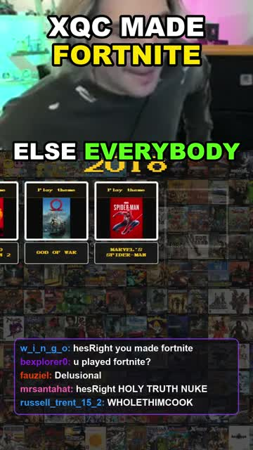
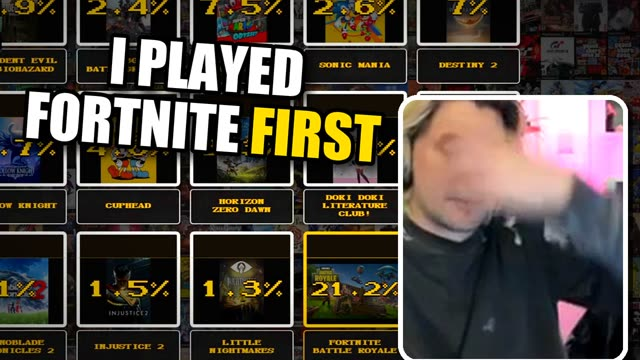
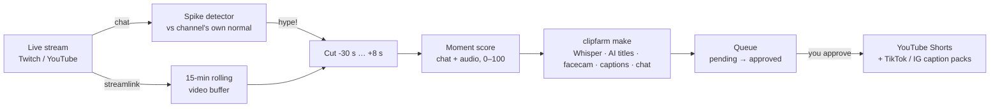

# Clippy

**Catches the moments chat goes crazy on Twitch and YouTube Live streams and turns them into ready-to-post vertical Shorts.**

When something wild happens on stream, chat explodes a few seconds later. Clippy watches chat for that spike,
cuts the video from ~30 s *before* it, scores how big the moment really was, and renders a 1080×1920 Short with
a facecam stack, a hook, word-by-word captions and (for the biggest moments) the real chat reacting.
You approve each clip before it posts, or in a live run, highlight clips that pass a safety check post by themselves.

<p align="center">
  
  &nbsp;&nbsp;
  
</p>

## How it works



| Step | What happens | Tech |
|---|---|---|
| Watch | Records each channel into 10 s segments; reads chat anonymously | streamlink, ffmpeg, Twitch IRC, yt-dlp |
| Detect | **Volume:** chat ≥ 3× faster than the channel's own normal. **Wave:** ≥ 30 % of chatters type the same thing at once ("OOOO", "HUH"), which catches huge chats that Twitch caps at ~12 msg/s | `detector.py` |
| Score | Chat spike (60 pts) + audio jump (40 pts): screams and explosions count | `score.py` |
| Edit | Transcribe → AI picks the 15–30 s payoff window, hook and titles → finds the facecam → renders | mlx-whisper, OpenRouter, OpenCV YuNet, Pillow, ffmpeg |
| Post | Approval queue → YouTube upload; ready-to-paste captions for TikTok / Instagram | Composio |

## Quick start

Requires an **Apple Silicon Mac** (speech-to-text uses mlx-whisper), Python 3.12 and [uv](https://docs.astral.sh/uv/).

```bash
brew install ffmpeg
git clone https://github.com/ancuong1610/Clippy && cd Clippy
uv sync
cp .env.example .env        # add your OpenRouter key (and Composio key for posting)
uv run pytest               # unit tests, no network needed
```

For Twitch VOD chat, download [TwitchDownloaderCLI](https://github.com/lay295/TwitchDownloader/releases) (MIT)
and put the binary in `tools/`.

## Usage

```bash
# 1. Live: watch every channel in channels.toml, clip the hype moments as they happen
uv run clipfarm run
uv run clipfarm run --test-trigger 120         # pipeline check: force a clip after 120 s

# 1b. Joining late? Scan only the last N minutes of a live stream's VOD (~75 s, not the whole chat)
uv run clipfarm catchup xqc --minutes 40 --top 5
uv run clipfarm run --only xqc,kaicenat        # …then track live from now on

# 1c. After the stream: find spikes in a full VOD's chat, download only those sections
tools/TwitchDownloaderCLI chatdownload -u https://www.twitch.tv/videos/<id> -o chat.json
uv run clipfarm analyze chat.json --vod https://www.twitch.tv/videos/<id> --top 10

# 2. Raw clip -> finished Short + thumbnails (titles, trim, facecam, captions, chat)
uv run clipfarm make clips/xqc/<clip>.mp4 --streamer xQc --context "GTA 6 livestream"

# 3. Review and post
uv run clipfarm queue add clips/xqc/<clip>_short.mp4
uv run clipfarm queue list
uv run clipfarm queue approve <id>             # nothing is posted without this
uv run clipfarm post --dry-run                 # shows exactly what would be sent
uv run clipfarm post
```

**Auto-post (live run only).** With `auto_post_min_score = 70` in `[post]`, `clipfarm run` edits every highlight
clip and uploads it to YouTube without a human step. Clips skip auto-post and wait in `queue/pending/` when:
- the AI flags a risk (copyrighted music, sexual content, hate, harassment, a minor on screen, or an unclear
  moment), or its safety answer is missing;
- `auto_post_max_per_hour` (default 2) is reached.

Every decision is logged to `queue/autopost.jsonl`. Comment out `auto_post_min_score` to turn it off.

Clips land in `clips/<channel>/<time>_s<score>.mp4` with a `.json` holding the chat, score and spike time.
Clips scoring below `min_score` go to `clips/<channel>/low/`.

<details>
<summary>Lower-level commands</summary>

| Command | Does |
|---|---|
| `clipfarm title <clip>` | Only the AI step: 3 YouTube titles, descriptions, TikTok/IG captions, hook text, best window |
| `clipfarm edit <clip> --layout blur\|square\|stack --captions karaoke\|hormozi\|classic` | Only the render, with manual options |
| `clipfarm thumb <clip> --text "HE GOT *CAUGHT*" --format both` | Thumbnails (16:9 and 9:16, 3 variants each) |

`*word*` marks the payoff word, shown in yellow in hooks and thumbnails.
</details>

## The house style

`clipfarm make` produces the approved look:

- **Layout:** facecam found automatically and stacked on top, gameplay below. Blur layout if there's no facecam.
- **Hook:** 2–4 word banner that makes sense on its own (`XQC MADE *FORTNITE*`).
- **Captions:** two words at a time, the spoken word in green. The AI fixes misheard names (`fortnight` → `Fortnite`).
- **Length:** trimmed to the 15–30 s window that holds the setup and the payoff.
- **Chat column (score ≥ 70):** up to 6 real chat messages picked by the AI, plus a local filter that blocks slurs,
  sexual content, links and personal info. Twitch-coloured names, shown for ~9 s around the payoff.
  `--chat on|off` overrides.
- **Thumbnails:** big facecam sticker + action frame + 1–4 huge words. Rules for the look are in the
  [youtube-thumbnail skill](.claude/skills/youtube-thumbnail/SKILL.md).

## Configuration

Everything lives in [channels.toml](channels.toml):

| Section | Key settings |
|---|---|
| `[clip]` | `length` (`auto` / `15-30` / `30-60`), `min_score`, `quality` |
| `[detector]` | `ratio` (3.0; lower means more clips), `min_unique`, `cooldown_s` |
| `[[channel]]` | `name` and `platform` (`twitch` / `youtube`); optional per-channel `[channel.detector]` |
| `[post]` | `platforms`, `min_queue_score`, `tags`, `credit_template`, `youtube_privacy`, `context`, `auto_post_min_score`, `auto_post_max_per_hour` |

Keys go in `.env` (see [.env.example](.env.example)):

| Key | For | Cost |
|---|---|---|
| `OPENROUTER_API_KEY` | titles, hooks, window, caption fixes, chat picks | a few cents per clip |
| `COMPOSIO_API_KEY` | YouTube upload | free tier |

Account setup for YouTube, TikTok, Instagram, Composio and Whop: [docs/account-setup.md](docs/account-setup.md).

## Project layout

```
src/clipfarm/
  __init__.py      CLI + live runner
  recorder.py      streamlink → ffmpeg segment buffer
  chat.py          Twitch IRC + YouTube live chat readers
  detector.py      adaptive chat-spike detector
  clipper.py       cut a window out of the buffer
  score.py         moment score (chat + audio)
  titles.py        OpenRouter prompt: titles, hook, window, fixes, chat picks
  face.py          facecam detection (YuNet)
  edit.py          vertical render, captions, hook banner
  chatoverlay.py   chat column: pick, filter, schedule, draw
  thumb.py         thumbnails
  make.py          one-shot pipeline used by `clipfarm make`
  catchup.py       last-N-minutes scan of a live stream's VOD
  autopost.py      unattended highlight posting with safety gate + rate limit
  post.py          approval queue + Composio YouTube upload
  fonts.py         font lookup (macOS fonts, free fallbacks elsewhere)
scripts/composio_youtube.py   connect a YouTube channel to Composio / test an upload
docs/                         design notes and research, account setup
tests/                        unit tests (no network)
```

## Status and limits

- **Verified:** live recording and clipping (Twitch, YouTube Live), VOD spike cutting, the full `make` pipeline
  (~45 s per clip on an M4), and public-capable YouTube uploads through Composio.
- **Not verified yet:** a real live spike firing end to end without the test trigger.
- **Mac only** for now: mlx-whisper needs Apple Silicon. Off macOS the fonts fall back to free stand-ins.
- **Posting:** only YouTube is automatic. TikTok and Instagram APIs allow only private posts for unaudited apps,
  so those platforms get caption files to paste by hand.
- Kick isn't supported.

## Responsible use

Clippy cuts other people's streams. Credit the streamer in every post (the `credit_template` does it), follow each
platform's reused-content rules (YouTube wants commentary or transformation, not raw re-uploads), and respect
streamers who don't allow clipping. Titles must match what's in the clip; the AI prompt enforces that.
Background research: [docs/design.md](docs/design.md).

## License

[MIT](LICENSE). Third-party tools keep their own licenses: streamlink (BSD-2), yt-dlp (Unlicense),
ffmpeg (LGPL/GPL), TwitchDownloader (MIT), OpenCV (Apache-2.0), mlx-whisper (MIT).
