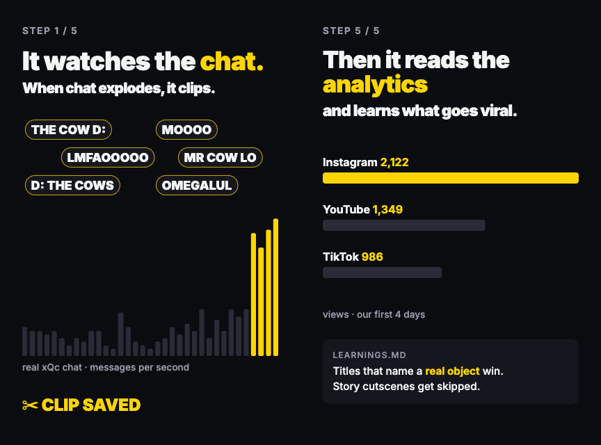
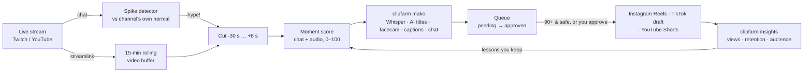

# Clippy

**Catches the moments chat goes crazy on Twitch and YouTube Live streams and turns them into ready-to-post vertical Shorts.**

When something wild happens on stream, chat explodes a few seconds later. Clippy watches chat for that spike,
cuts the video from ~30 s *before* it, scores how big the moment really was, and renders a 1080×1920 Short with
a facecam stack, a hook, word-by-word captions and (for the biggest moments) the real chat reacting.
It posts to Instagram Reels, TikTok and YouTube Shorts on a schedule, then pulls each post's analytics to learn
what actually goes viral. You review the borderline clips; the clear highlights that pass a safety check post themselves.

### ▶ Demo: "My AI clips GTA 6 streamers while I sleep" (34 s)

[](https://www.instagram.com/reel/DgBSkCRjIR9/)

[Watch the video on Instagram](https://www.instagram.com/reel/DgBSkCRjIR9/). It walks through the five steps below on a real
clip (xQc vs. a herd of cows): chat spike → AI judge (cutscene 35, crash 100) → hook cut one beat before impact →
auto-post → analytics. Made with [Remotion](https://www.remotion.dev) from this repo's own data; source in [promo/](promo/).

<p align="center">
  
  &nbsp;&nbsp;
  
</p>

## How it works



| Step | What happens | Tech |
|---|---|---|
| Watch | Records each channel into 10 s segments; reads chat anonymously | streamlink, ffmpeg, Twitch IRC, yt-dlp |
| Detect | **Volume:** chat ≥ 3× faster than the channel's own normal. **Wave:** ≥ 30 % of chatters type the same thing at once ("OOOO", "HUH"), which catches huge chats that Twitch caps at ~12 msg/s | `detector.py` |
| Score | Chat spike (60 pts) + audio jump (40 pts) nominate; an AI judge watches frames + chat and rates 0–100 | `score.py`, `judge.py` |
| Edit | Transcribe → AI picks the 15–30 s payoff window, hook and titles → finds the facecam → renders | mlx-whisper, OpenRouter, OpenCV YuNet, Pillow, ffmpeg |
| Post | Approval queue → Instagram Reel (public), TikTok (draft + caption to your phone), YouTube Short | Composio, ntfy |
| Learn | Per-post views, % watched, 3 s hook retention, shares; audience age / country / traffic → report + proposed lessons | YouTube Analytics, IG Insights |

## Quick start

Requires an **Apple Silicon Mac** (speech-to-text uses mlx-whisper), Python 3.12 and [uv](https://docs.astral.sh/uv/).

```bash
brew install ffmpeg
git clone https://github.com/ancuong1610/Clippy && cd Clippy
uv sync
cp .env.example .env        # add your OpenRouter key (and Composio key for posting)
uv run pytest               # unit tests, no network needed
```

For Twitch VOD chat, download [TwitchDownloaderCLI](https://github.com/lay295/TwitchDownloader/releases) (MIT)
and put the binary in `tools/`.

## Usage

```bash
# 1. Live: watch every channel in channels.toml, clip the hype moments as they happen
uv run clipfarm run
uv run clipfarm run --test-trigger 120         # pipeline check: force a clip after 120 s

# 1b. Joining late? Scan only the last N minutes of a live stream's VOD (~75 s, not the whole chat)
uv run clipfarm catchup xqc --minutes 40 --top 5
uv run clipfarm run --only xqc,kaicenat        # …then track live from now on

# 1c. After the stream: find spikes in a full VOD's chat, download only those sections
tools/TwitchDownloaderCLI chatdownload -u https://www.twitch.tv/videos/<id> -o chat.json
uv run clipfarm analyze chat.json --vod https://www.twitch.tv/videos/<id> --top 10

# 2. Raw clip -> finished Short + thumbnails (titles, trim, facecam, captions, chat)
uv run clipfarm make clips/xqc/<clip>.mp4 --streamer xQc --context "GTA 6 livestream"

# 3. Review and post
uv run clipfarm queue add clips/xqc/<clip>_short.mp4
uv run clipfarm queue list
uv run clipfarm queue approve <id>             # nothing is posted without this
uv run clipfarm post --dry-run                 # shows exactly what would be sent
uv run clipfarm post
uv run clipfarm post --watch                   # poster only: best approved clip per slot, all day

# 4. Learn and tidy up
uv run clipfarm insights                       # analytics -> reports/insights-<date>.md + proposed lessons
uv run clipfarm cleanup                        # lists what it would delete; --apply to free the disk
uv run clipfarm post --youtube-backlog 2       # YouTube was resting: upload the 2 best clips it skipped
```

**What counts as a highlight.** Chat waves (laughter, o7, emote floods) and chat speed only nominate moments. An AI
judge then looks at 12 frames plus the chat and rates the clip 0–100 against reference moments in
[judge_examples.toml](judge_examples.toml): xQc's GTA 6 seaplane crash = 95, the shark scene = 90, gym and
menus ≈ 45, a bar cutscene chat laughs at = 35. It scores payoff, stakes, legibility (sound off, 3 s) and surprise,
anchored on the owner's review of 79 clips: crashes, stunts and weird world moments got approved, story cutscenes
did not (7/35). Cutscenes are capped at 80 unless the streamer caused the chaos. Gameplay that already shows a
payoff (≥ 80) gets up to **+15** when chat answers as one (35–60 % of chatters in the same mood). Add your own
picks to that file to teach it; the bar is `[judge] min_hype = 90`. `scripts/backtest_judge.py` re-judges reviewed
clips and prints precision/recall against your yes/no.

**Hook.** Every Short opens with a 1.5 s tease that ends **one beat before impact**: the judge names the payoff
moment, a second AI pass looks at frames 0.4 s apart around it to find first contact, and the tease stops 0.3 s
before it (fallback: 1 s before the loudest moment). It runs under a banner that asks a question without giving
the answer (`XQC VS THE *COW*`), then the clip plays from the start.

**Auto-post.** Clips at or above `auto_post_min_score` (90) are edited and queued for posting without a human
step. They wait in `queue/pending/` for you instead when the AI flags a risk (sexual content, hate, harassment,
a minor on screen, an unclear moment) or its safety answer is missing. Posting is rolling: the **best waiting
clip** goes out first, at least `auto_post_min_gap_min` apart, under `auto_post_max_per_hour` and
`auto_post_max_per_day` (rolling 24 h, manual uploads included). With `auto_post_slots` (e.g. 19:00 / 22:00 /
01:00 Berlin) each day's batch rotates through the slots so `clipfarm insights` can compare them; every upload
waits a random 0–`auto_post_jitter_min` minutes so it never runs on a fixed clock.

`auto_platforms` picks where the poster posts: Instagram Reels go public at once; TikTok gets a **draft** in the
app's inbox (unaudited apps can't post publicly) and the caption is pushed to your phone via
[ntfy](https://ntfy.sh) (`NTFY_TOPIC`), so posting it is one tap. Leave `"youtube"` out to **rest the channel**
(e.g. after a burst of uploads): clips still go to the other platforms, are marked `youtube_pending`, and
`clipfarm post --youtube-backlog N` uploads them later, best first. Every decision is logged to
`queue/autopost.jsonl`.

**Analytics and learning.** `clipfarm insights` (also once a day inside `post --watch`) pulls YouTube Analytics
(views, % watched, retention at 3 s, shares, subscribers gained), Instagram Reel insights (views, reach, average
watch time, shares, saves) and TikTok counts, joins them with each clip's judge score, kind, streamer, banner and
post hour, and writes `reports/insights-<date>.md`: does the hype score predict reach, which kinds / streamers /
hours / hooks hold viewers, top and bottom 5, audience age, country and traffic source. An AI then appends three
**proposed** lessons and one thing to test next to `learnings.md`; you keep or drop them. Posts made by hand are
matched to their clip by caption. Data: `queue/insights.jsonl`, `queue/audience.jsonl` (reports and lessons stay
out of git).

**Disk cleanup.** `clipfarm cleanup` deletes the video of posted clips after `posted_days` (time to post them by
hand elsewhere), of skipped / rejected clips after `skipped_days`, and raw clips that never made the queue after
`raw_days`. Source clips you reviewed are shrunk to 640 px instead, so judge backtests still run on them. Every
`.json` stays; `approved/`, `pending/` and `failed/` are never touched. `[cleanup] auto = true` runs it hourly
inside `post --watch`.

**Review page.** `scripts/review_docs.py` builds one record per queued clip (video, score, judge's payoff,
TikTok/IG captions) for a review page; `scripts/apply_reviews.py <exported reviews>` moves your "no" to
`queue/skipped/` and "yes" to `queue/approved/`. `scripts/rerender_queue.py --rejudge` re-scores queued clips with
the current judge and re-renders them with fresh titles and hooks.

Clips land in `clips/<channel>/<time>_s<score>.mp4` with a `.json` holding the chat, score and spike time.
Clips scoring below `min_score` go to `clips/<channel>/low/`.

<details>
<summary>Lower-level commands</summary>

| Command | Does |
|---|---|
| `clipfarm title <clip>` | Only the AI step: 3 YouTube titles, descriptions, TikTok/IG captions, hook text, best window |
| `clipfarm edit <clip> --layout blur\|square\|stack --captions karaoke\|hormozi\|classic` | Only the render, with manual options |
| `clipfarm thumb <clip> --text "HE GOT *CAUGHT*" --format both` | Thumbnails (16:9 and 9:16, 3 variants each) |

`*word*` marks the payoff word, shown in yellow in hooks and thumbnails.
</details>

## The house style

`clipfarm make` produces the approved look:

- **Layout:** facecam found automatically and stacked on top, gameplay below. Blur layout if there's no facecam.
- **Hook:** 2–4 word banner that makes sense on its own (`XQC MADE *FORTNITE*`).
- **Captions:** two words at a time, the spoken word in green. The AI fixes misheard names (`fortnight` → `Fortnite`).
- **Length:** trimmed to the 15–30 s window that holds the setup and the payoff.
- **Chat column (score ≥ 70):** up to 6 real chat messages picked by the AI, plus a local filter that blocks slurs,
  sexual content, links and personal info. Twitch-coloured names, shown for ~9 s around the payoff.
  `--chat on|off` overrides.
- **Thumbnails:** big facecam sticker + action frame + 1–4 huge words. Rules for the look are in the
  [youtube-thumbnail skill](.claude/skills/youtube-thumbnail/SKILL.md).

## Configuration

Everything lives in [channels.toml](channels.toml):

| Section | Key settings |
|---|---|
| `[clip]` | `length` (`auto` / `15-30` / `30-60`), `min_score`, `quality` |
| `[detector]` | `ratio` (3.0; lower means more clips), `min_unique`, `cooldown_s` |
| `[[channel]]` | `name` and `platform` (`twitch` / `youtube`); optional per-channel `[channel.detector]` |
| `[post]` | `platforms`, `auto_platforms`, `min_queue_score`, `tags`, `credit_template`, `context`, `auto_post_min_score`, `auto_post_max_per_day`, `auto_post_slots` |
| `[judge]` | `min_hype` (the highlight bar, 90) |
| `[[campaign]]` | paid clipping campaigns: accepted streamers, required hashtags, logo |
| `[cleanup]` / `[insights]` | `auto`, and the cleanup grace periods in days |

Keys go in `.env` (see [.env.example](.env.example)):

| Key | For | Cost |
|---|---|---|
| `OPENROUTER_API_KEY` | titles, hooks, window, caption fixes, chat picks | a few cents per clip |
| `COMPOSIO_API_KEY` | posting (YouTube, Instagram, TikTok) and analytics | free tier |
| `NTFY_TOPIC` | phone push with the caption for each TikTok draft | free |

Account setup for YouTube, TikTok, Instagram, Composio and Whop: [docs/account-setup.md](docs/account-setup.md).

## Project layout

```
src/clipfarm/
  __init__.py      CLI + live runner
  recorder.py      streamlink → ffmpeg segment buffer
  chat.py          Twitch IRC + YouTube live chat readers
  detector.py      adaptive chat-spike detector
  clipper.py       cut a window out of the buffer
  score.py         moment score (chat + audio)
  titles.py        OpenRouter prompt: titles, hook, window, fixes, chat picks
  face.py          facecam detection (YuNet)
  edit.py          vertical render, captions, hook banner
  chatoverlay.py   chat column: pick, filter, schedule, draw
  thumb.py         thumbnails
  make.py          one-shot pipeline used by `clipfarm make`
  catchup.py       last-N-minutes scan of a live stream's VOD
  judge.py         AI judge: frames + chat -> 0-100, payoff time, impact frame for the hook
  autopost.py      unattended highlight posting with safety gate + rate limit
  post.py          approval queue + Composio posting (YouTube, Instagram, TikTok draft), ntfy push
  campaigns.py     route a clip to the paid campaign that accepts its streamer
  insights.py      post analytics -> dataset, report, proposed lessons
  cleanup.py       disk cleanup rules
  fonts.py         font lookup (macOS fonts, free fallbacks elsewhere)
scripts/                     Composio YouTube test, judge backtest, queue re-render, review page records
promo/                        Remotion project for the demo video
docs/                         design notes and research, account setup
tests/                        unit tests (no network)
```

## Status and limits

- **Verified:** live recording and clipping (Twitch, YouTube Live), VOD spike cutting, the full `make` pipeline
  (~45 s per clip on an M4), public YouTube and Instagram posts and TikTok drafts through Composio, and
  analytics pulls from all three.
- **Not verified yet:** a real live spike firing end to end without the test trigger.
- **Mac only** for now: mlx-whisper needs Apple Silicon. Off macOS the fonts fall back to free stand-ins.
- **Posting:** YouTube and Instagram Reels are fully automatic. TikTok's API lets unaudited apps post only
  privately, so TikTok gets a draft in the app plus the caption on your phone; publishing it is one tap.
- **Analytics:** Instagram audience demographics need ~100 followers before the API returns them; TikTok's API
  gives only counts (views, likes, shares), not retention.
- Kick isn't supported.

## Responsible use

Clippy cuts other people's streams. Credit the streamer in every post (the `credit_template` does it), follow each
platform's reused-content rules (YouTube wants commentary or transformation, not raw re-uploads), and respect
streamers who don't allow clipping. Titles must match what's in the clip; the AI prompt enforces that.
Background research: [docs/design.md](docs/design.md).

## License

[MIT](LICENSE). Third-party tools keep their own licenses: streamlink (BSD-2), yt-dlp (Unlicense),
ffmpeg (LGPL/GPL), TwitchDownloader (MIT), OpenCV (Apache-2.0), mlx-whisper (MIT).
